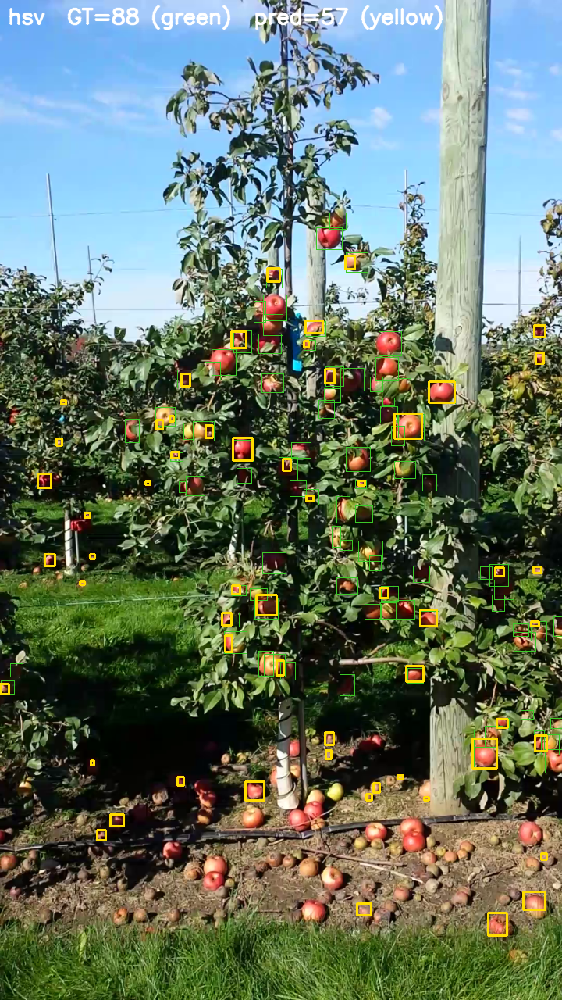
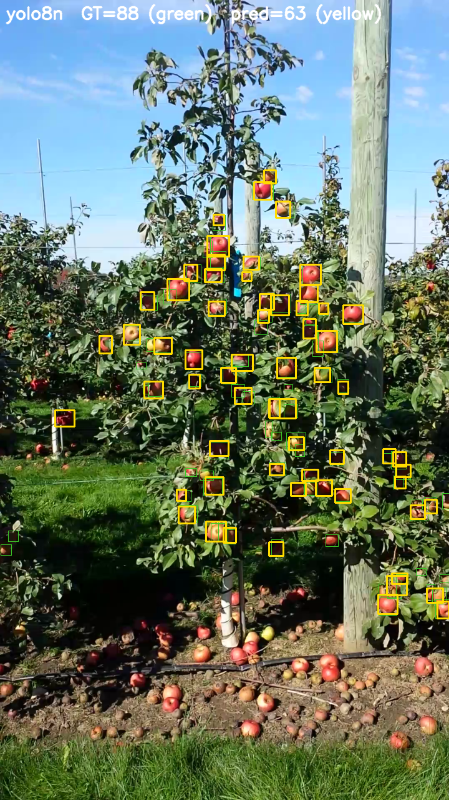
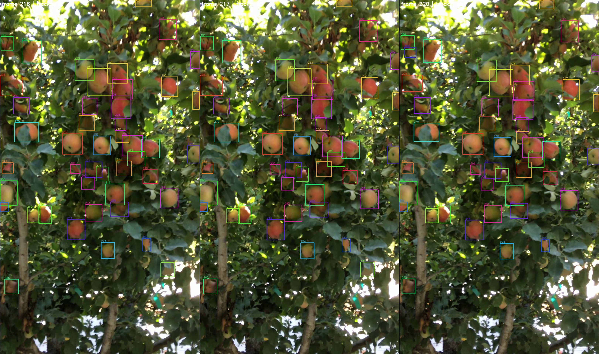

# AppleCounter

Код для статьи в журнал ВАК: считаем яблоки на деревьях по видео. Пайплайн
берёт ролик прохода камеры вдоль ряда, детектирует плоды (классический HSV
как нижняя граница и две версии YOLO), сопровождает их трекерами и выдаёт
число уникальных яблок с привязкой к участкам ряда. Задача — чтобы одно
физическое яблоко не попало в ответ дважды, поэтому основной предмет
сравнения здесь не сами детекции, а качество удержания идентификаторов.

Проект в активной разработке: результаты ниже — реальные прогоны, а не
демо-заглушки. Полный промежуточный отчёт с таблицами, метриками и
расшифровкой протокола: [report/REPORT.pdf](report/REPORT.pdf).

## Что уже посчитано

Детекция на валидации MinneApple (331 изображения, в среднем 37 яблок на
кадр). Ниже — один и тот же кадр с разметкой детектора; жёлтым предсказания,
зелёным GT:

| HSV-бейзлайн | YOLOv8n (50 эпох) |
|---|---|
|  |  |

Цифры к картинкам (AP@0.50, свой протокол оценки, см. отчёт):

| Детектор | AP50 | Precision | Recall | F1 |
|---|---|---|---|---|
| HSV | 0.016 | 0.130 | 0.120 | 0.125 |
| YOLOv8n@640 | 0.656 | 0.759 | 0.698 | 0.727 |
| YOLO26s@1280 | 0.775 | 0.740 | 0.817 | 0.777 |

Трекинг оцениваем на T1 — датасете Villacres et al. (Zenodo 7384297,
Computers and Electronics in Agriculture, 2022): 1290 кадров одного прохода
с MOT-разметкой, 939 размеченных яблок. Это единственный датасет в работе, где
есть GT для трекинга. Три соседних кадра с ID-метками треков (yolo8n +
BoT-SORT, кадры с максимальной плотностью сцены):



| Детектор | Трекер | MOTA | IDF1 | ID switches |
|---|---|---|---|---|
| HSV | BoT-SORT | −0.121 | 0.045 | 15 |
| YOLOv8n | BoT-SORT | **0.278** | **0.468** | **81** |
| YOLOv8n | DeepSORT | 0.245 | 0.412 | 272 |
| YOLO26s | BoT-SORT | 0.262 | 0.431 | 72 |
| YOLO26s | DeepSORT | 0.215 | 0.345 | 249 |

На данный момент лучшая комбинация — **YOLOv8n + BoT-SORT**: меньше всего
«двойного счёта» (IDF1) при лучшей суммарной точности трекинга (MOTA).
DeepSORT в 3 раза чаще теряет и переназначает идентификаторы. YOLO26s сильнее
на родном домене (MinneApple), но на чужом T1 разница с YOLOv8n в пределах
шума — обе модели обучены только на MinneApple.

Третий датасет — VideoFruitCounting (16 видео, две камеры). Там нет разметки
ни объектов, ни чисел, только метки-разделители участков ряда, поэтому на нём
считается внутренняя согласованность (сколько уникальных треков и насколько
устойчиво), а не точность. HSV-фаза (32 прогона) закончена; YOLO-фазы
досчитываются. Почему точность счёта на VFC заявить нельзя и какие выводы
из этого следуют — раздел 4.1 отчёта.

## Запуск

Windows:

```powershell
python -m venv .venv
.venv\Scripts\python.exe -m pip install -e ".[dev,yolo,trackers,eval]"
.venv\Scripts\python.exe -m applecounter demo --out outputs\demo
.venv\Scripts\python.exe -m pytest        # 112 тестов
```

macOS / Linux — то же самое с `.venv/bin/pip` и `.venv/bin/python`. В Colab:
клонировать, `pip install -e ".[dev,yolo,trackers,eval]"`, дальше команды те
же. Для GPU ставьте PyTorch из `https://download.pytorch.org/whl/cu126`.

Один прогон по видео:

```powershell
.venv\Scripts\python.exe -m applecounter run --video flight.mp4 --out outputs\flight `
  --set detector.name=yolo `
  --set detector.yolo.weights=weights/runs/minneapple50/weights/best.pt `
  --set tracker.name=botsort
```

Исследовательская матрица (T1: 6 прогонов, VFC: 96; задачи со валидным
манифестом пропускаются, поэтому после сбоя прогон просто стартуешь заново):

```powershell
.venv\Scripts\python.exe scripts\run_matrix.py --dataset t1
.venv\Scripts\python.exe scripts\run_matrix.py --dataset vfc
```

## Данные

В репозиторий данные и веса не входят. MinneApple — публичный датасет
Henningson & Smith; T1 берётся с [Zenodo 7384297](https://zenodo.org/records/7384297);
VFC — [imatge-upc/VideoFruitCounting](https://github.com/imatge-upc/VideoFruitCounting).
Веса экспериментов обучены на MinneApple (YOLOv8n, 50 эпох, 640 px; YOLO26s,
40 эпох, 1280 px) и по запросу передаются соавторам; переобучить можно
командой `applecounter train`.

## Этап соавтора: ByteTrack

ByteTrack уже подключён через общий интерфейс (`tracker.name=bytetrack`,
адаптер — `src/applecounter/track/external.py`, детали —
[docs/adding_a_tracker.md](docs/adding_a_tracker.md)). Этап напарника без
правок ядра: добавить `bytetrack` в список трекеров матрицы
(`scripts/run_matrix.py`), прогнать T1 и VFC — кэш детекции общий, YOLO
повторно не считается — и сравнить MOTA/IDF1/IDSW с нашей таблицей выше.

## Структура

`src/applecounter/` — пакет (детекция, трекинг, счёт, деревья, метрики,
CLI) · `scripts/` — матрица прогонов, ночной сценарий, сборка отчёта ·
`report/` — промежуточный отчёт и рисунки · `docs/` — протокол эксперимента,
план прогонов · `paper/` — черновик статьи (LaTeX) · `tests/` — тесты.

## Честные оговорки

- Старые результаты из первой версии кода сохранены локально в `outputs/`,
  но в выводы не идут: там не было корректных GT ID и границ деревьев.
- Метрики трекинга (MOTA/IDF1/IDSW) измеряют качество траекторий. Они —
  лучший доступный прокси «не пересчитать яблоко дважды», но не доказывают
  точность итогового счёта без count GT; на VFC такой разметки не будет,
  и это принципиальное ограничение постановки, а не недоделка кода.
- Прогноз урожая в килограммах — только после полевой калибровки; до неё
  оценка иллюстративная.

Лицензия кода — MIT. Датасеты и внешние пакеты сохраняют свои лицензии.
