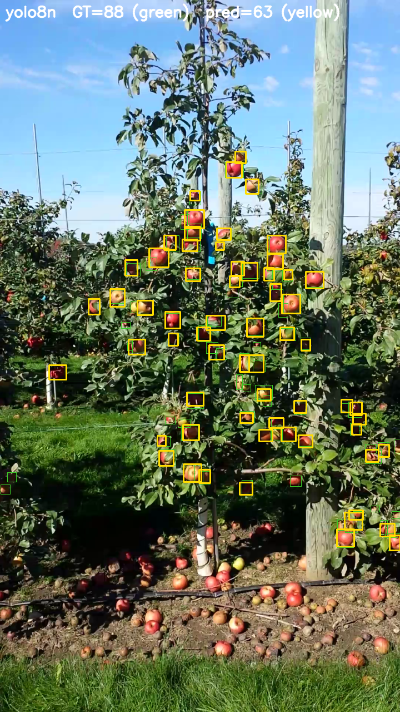
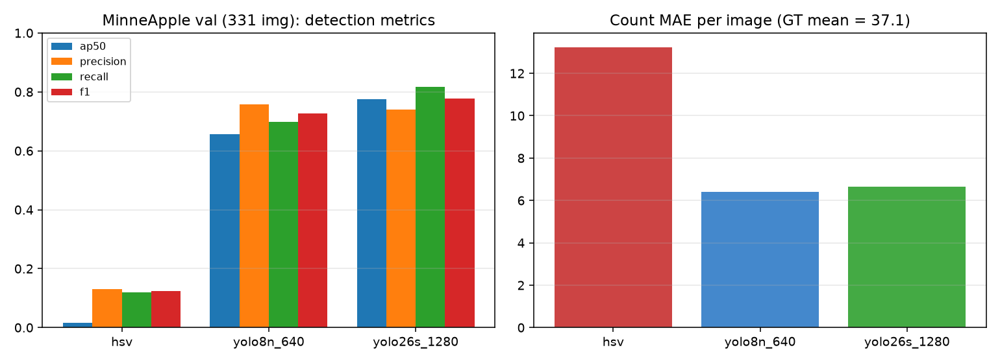
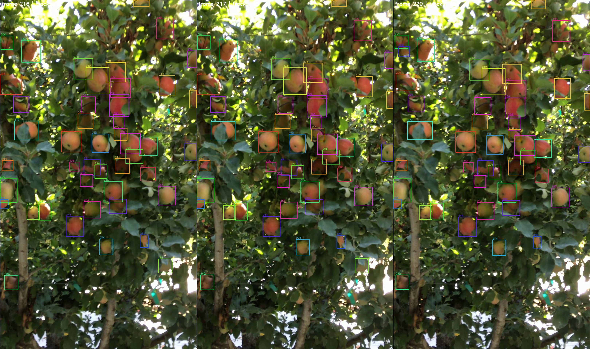
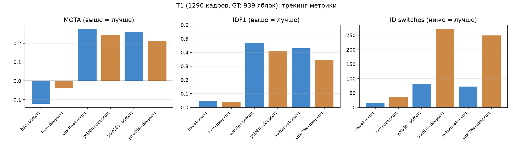
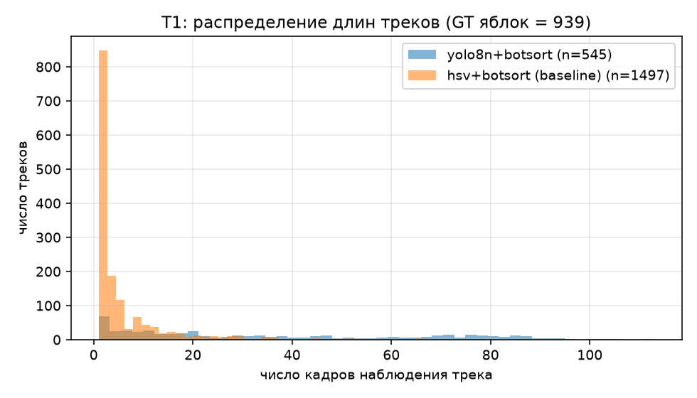

# Промежуточный отчёт: подсчёт яблок на деревьях по видео

**Дата:** 09.11.2026 · **Коммит кода:** `ae5b3c6` · **Статус:** промежуточный результат для доклада

## 1. Сводка статуса

| Этап | Статус |
|---|---|
| Детекция на MinneApple val (HSV / YOLOv8n / YOLO26s) | ✅ 3/3 готово |
| MOT-матрица T1 (3 детектора × 2 трекера) | ✅ 6/6 готово |
| VFC, фаза HSV (16 видео × 2 трекера) | ✅ 32/32 готово |
| VFC, фаза YOLOv8n | 🔄 2/32 (в работе) |
| VFC, фаза YOLO26s | ⏳ очередь |
| Ручной count GT для VFC | ❌ не начат — блокирует абсолютную ошибку счёта на VFC |

Прогоны выполняются автоматическим сценарием `scripts/overnight_experiments.ps1` «в лоб», одна задача за раз; сценарий возобновляем — после сбоя питания валидные задачи пропускаются. Каждый прогон фиксирует манифест с SHA-256 входного видео и конфигурацией.

## 2. Датасеты

- **MinneApple** — кадры яблонь с боксовой разметкой; использован для обучения и валидации детекции (train 670 / val 331 изображение, 40 464 GT-боксов). Не используется для видеотрекинга.
- **T1** — датасет Villacres et al. (Zenodo 7384297, Computers and Electronics in Agriculture 2022): последовательность из 1290 кадров с MOT-разметкой (939 яблок, 48 111 боксов). Единственный датасет в работе, где есть GT для трекинга — источник метрик MOTA/IDF1/IDSW.
- **VideoFruitCounting (VFC)** — 16 видео с двух камер (Azure Kinect, ~8–9 тыс. кадров каждое). Счёт ведётся по 21 stretch-маркеру (vfc_reference). GT числа яблок отсутствует — метрики точности детекции/трекинга там недостижимы, возможна только внутренняя согласованность.

## 3. Пайплайн

`видео → детекция (HSV | YOLOv8n@640 | YOLO26s@1280) → кэш детекции (SHA-256, проверка конфигурации) → трекинг (BoT-SORT | DeepSORT, внешний ByteTrack — партнёрский этап) → MOT-метрики (motmetrics) → подсчёт уникальных треков → привязка к stretch/деревьям → отчёт`.

## 4. Описание используемых метрик

| Метрика | Уровень | Что означает и как влияет |
|---|---|---|
| AP@0.50 | Детекция | Average Precision при IoU=0.50: средняя точность детекции по всем порогам уверенности. Основная метрика качества детектора. Выше — лучше. |
| Precision | Детекция | Доля верных срабатываний среди всех предсказанных боксов (TP/(TP+FP)). Высокая precision = мало ложных срабатываний. Выше — лучше. |
| Recall | Детекция | Доля найденных GT-объектов (TP/(TP+FN)). Высокий recall = мало пропущенных яблок. Выше — лучше. |
| F1 | Детекция | Среднее гармоническое precision и recall: баланс одной цифрой. Выше — лучше. |
| Count MAE | Счёт | Средняя абсолютная ошибка числа яблок на изображение/видео. Прямо измеряет качество подсчёта урожая. Ниже — лучше. |
| MOTA | Трекинг | Multiple Object Tracking Accuracy: 1 − (FN+FP+IDSW)/GT. Комплексная точность трекинга с учётом пропусков, ложных срабатываний и смен идентификаторов. Может быть отрицательной. Выше — лучше. |
| IDF1 | Трекинг | F1-метрика идентификации: насколько правильно трекер сохраняет тождество объектов (сколько наблюдений отнесено к правильному ID). Ключевая метрика для задачи «не пересчитывать одно яблоко дважды». Выше — лучше. |
| ID switches (IDSW) | Трекинг | Число смен идентификатора у одного физического объекта: прямой показатель дробления треков и двойного счёта. Ниже — лучше. |
| unique_counted | Счёт | Число уникальных подтверждённых треков, принятых за отдельные яблоки. Без count GT — внутренняя согласованность, а не точность. |

Полные определения с формулами — в `report/metrics_legend.csv`.

## 5. Результаты: MinneApple val (детекция)

| Детектор | AP@0.50 | Precision | Recall | F1 | Count MAE/изобр. | Среднее предск. | GT |
|---|---|---|---|---|---|---|---|
| hsv | 0.016 | 0.130 | 0.120 | 0.125 | 13.24 | 34.2 | 37.1 |
| yolo8n | 0.656 | 0.759 | 0.698 | 0.727 | 6.42 | 34.2 | 37.1 |
| yolo26s | 0.775 | 0.740 | 0.817 | 0.777 | 6.66 | 41.0 | 37.1 |

## 6. Результаты: T1 (трекинг, 1290 кадров, GT 939 яблок)

| Детектор | Трекер | AP@0.50 | MOTA | IDF1 | IDSW | Уникальных треков | трекинг, с/кадр |
|---|---|---|---|---|---|---|---|
| hsv | botsort | 0.003 | -0.121 | 0.045 | 15 | 1497 | 0.15 |
| hsv | deepsort | 0.003 | -0.037 | 0.041 | 37 | 835 | 0.10 |
| yolo8n | botsort | 0.387 | +0.278 | 0.468 | 81 | 545 | 0.39 |
| yolo8n | deepsort | 0.387 | +0.245 | 0.412 | 272 | 675 | 0.10 |
| yolo26s | botsort | 0.359 | +0.262 | 0.431 | 72 | 475 | 0.31 |
| yolo26s | deepsort | 0.359 | +0.215 | 0.345 | 249 | 623 | 0.09 |

## 7. Промежуточные результаты VFC

HSV-фаза закрыта полностью (16 видео × 2 трекера). По 16 видео BoT-SORT в среднем даёт 59,173 уникальных треков, DeepSORT — 51,080. Расхождение согласуется с T1 (у DeepSORT больше разрывов ID). YOLOv8n-фаза: 1 видео обоими трекерами; первые результаты: YOLOv8n+BoT-SORT 8 439 уникальных яблок на видео `210928_100624` против 60 792 у HSV — HSV-бейзлайн завышает счёт в ~7 раз, что согласуется с AP50=0.016 на MinneApple.

Детекция YOLOv8n на этом видео заняла 160 с (~57 к/с, CUDA), трекинг BoT-SORT — 304 мин; цена кадра трекинга растёт с числом детекций и активных треков — отмечено как ограничение производительности.

## 8. Что исправлено относительно исходной версии

Исходная реализация сохранена коммитом `f14b87e`. По результатам аудита и переработки (`c911144`, `a9aabcd`, `ae5b3c6`):

1. **Привязка к деревьям.** Раньше яблоко приписывалось группе деревьев, а не конкретной позиции; теперь единица счёта — stretch из SFRAME (vfc_reference), деревья не дробятся автоматически.
2. **Воспроизводимость.** Добавлены манифесты прогонов (SHA-256 входа, конфигурация, статус), кэш детекции валидируется по конфигурации и автоматически пересоздаётся при несовместимости (исправлено падение возобновления после обрыва питания).
3. **Сводная таблица.** Раньше каждая фаза затирала `matrix_results.csv`; теперь фазы сливаются, добавлен идемпотентный `scripts/rebuild_results.py`.
4. **Детекция.** MinneApple сконвертирован в YOLO-формат (data.yaml, 670/331), PyTorch переведён с CPU-сборки на CUDA (2.14.1+cu126, RTX 3050): детекция YOLO на видео ускорилась на порядки.
5. **Валидация.** 112 тестов; MOT-метрики через motmetrics; GT T1 проверен на валидность MOT (939 идентификаторов, 937 наблюдаются повторно).

## 9. Сравнительный анализ и выбор комбинации

**Детектор.** HSV-цветовой бейзлайн непригоден: AP50 = 0,016 (MinneApple) и 0,003 (T1), счёт завышен в разы — оставлен только как нижняя граница. YOLOv8n и YOLO26s сопоставимы: на MinneApple YOLO26s лучше по AP50 (0,775 против 0,656) и recall, по count MAE — паритет (6,7 против 6,4 яблока); на T1 YOLOv8n чуть лучше по AP50 (0,387 против 0,359). YOLO26s заметно дороже по времени детекции.

**Трекер.** BoT-SORT стабильно превосходит DeepSORT по удержанию идентификаторов: IDF1 0,468 против 0,412 (YOLOv8n) и 0,431 против 0,345 (YOLO26s); IDSW меньше в 2,7–3,4 раза (81 против 272; 72 против 249). Цена — время трекинга: BoT-SORT в 1,5–7 раз медленнее в зависимости от плотности сцен.

**Итог.** Оптимальная комбинация для задачи подсчёта — **YOLOv8n + BoT-SORT**: лучший MOTA (0,278) и IDF1 (0,468) на единственном датасете с трекинг-GT при минимальном времени детекции. **YOLO26s + BoT-SORT** — ближайшая альтернатива с лучшей детекцией на MinneApple (AP50 0,775) и точностью 0,809 — претендент №1 там, где важнее качество боксов, чем скорость. Окончательный выбор между ними для счёта урожая — только после ручного count GT на VFC.

## 10. Ограничения и следующие шаги

1. На VFC нет GT: без ручного count GT нельзя заявлять абсолютную ошибку счёта и выбирать метод по точности подсчёта (протокол разметки — `docs/research_run_plan.md`, раздел 4).
2. Фазы VFC YOLOv8n/YOLO26s досчитываются (~8–10 суток при текущей скорости).
3. ByteTrack — партнёрский этап поверх того же кэша и интерфейса.
4. Этап 3 (компенсация движения камеры, восстановление ID) — после текущей матрицы.
5. Прогноз урожая в кг — только после полевой калибровки массы; до неё — иллюстративный.